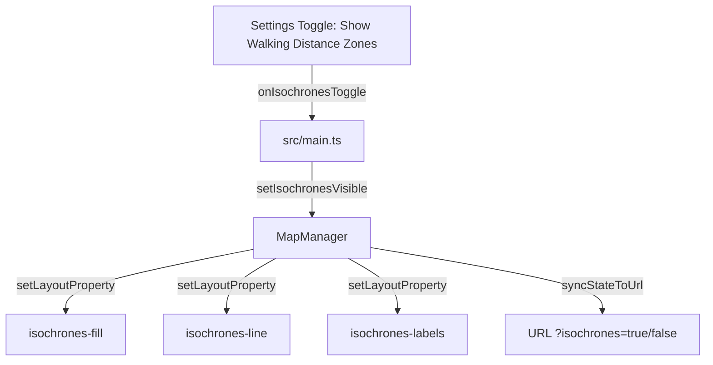

# Requirements

### Overview & Goals
Investigate and resolve why walking distance isochrone zones (5, 10, and 15-minute walksheds) are not clearly visible on the map even when `region.json` is loaded and settings toggles are enabled. Upgrade the isochrone rendering pipeline to ensure walking zones are distinctly visible, beautifully styled, properly layered beneath POI markers, and reactively toggleable across all basemap styles (Positron, Bright, Liberty) and device viewports.

### Scope
- **In Scope**:
  - Diagnose and resolve MapLibre layer styling, opacity, fontstack, and layer ordering issues preventing isochrones from being visible.
  - Enhance polygon fill opacities (`0.25` - `0.32`), vibrant walk-tier color ramps (5 min, 10 min, 15 min), and high-contrast perimeter boundary strokes (`line-width: 2.5px`, `line-opacity: 0.85`).
  - Fix polygon label rendering and font resolution (`Noto Sans Regular` fontstack and perimeter/contour labeling or legend badges).
  - Ensure robust layer lifecycle across initial load, settings toggle (`chk-show-isochrones`), URL parameter synchronization (`?isochrones=true/false`), and basemap style switches (`Positron`, `Bright`, `Liberty`).
  - Add comprehensive unit and integration tests verifying isochrone layer properties, visibility toggling, and style updates.
  - Update `FEATURES.md`, `documentation/user_guide.md`, and `documentation/developer_guide.md`.
- **Out of Scope**:
  - Re-generating raw spatial walkshed GeoJSON files (existing geometry in `region.json` and `regions/` is valid).
  - Modifying backend pipeline preprocessing scripts unless GeoJSON schema updates are required.

### User Stories
- **As a conference attendee**, I want to clearly see 5, 10, and 15-minute walking distance zones shaded on the map around the conference center so that I can immediately gauge how far venues are.
- **As a user switching basemap styles or toggling settings**, I want walking isochrone zones to toggle on and off instantly and remain clearly visible against both light (Positron), vibrant (Bright), and shaded (Liberty) vector map themes.
- **As a visually impaired user or user in bright sunlight**, I want isochrone boundaries and fills to have sufficient contrast and clear delineation so that they are not washed out against the white/gray map background.

### Functional Requirements
- **Isochrone Visual Prominence**: Isochrone polygon fills must have distinct, legible opacities (e.g. 5 min: `#2b83ba` @ 0.28, 10 min: `#64abb0` @ 0.22, 15 min: `#9dd3a7` @ 0.18) with solid, crisp boundary strokes (2.5px width) that stand out clearly on the map.
- **Font & Symbol Compatibility**: Isochrone label layers must explicitly define valid vector fontstacks (`Noto Sans Regular`) matching OpenFreeMap tiles or use boundary annotations to avoid symbol rendering / glyph load errors.
- **Layer Stacking**: Isochrone fills and outlines must sit beneath POI marker pins and selection rings but above basemap landuse/road fills so street names and POI pins remain crisp and unhampered.
- **Settings & URL Reactivity**: Toggling the "Show walking distance zones" checkbox in Settings or passing `?isochrones=false` / `?isochrones=true` must immediately update MapLibre layer visibility (`setLayoutProperty('visibility', ...)`).

# Technical Design

### Current Implementation
- `src/map/mapManager.ts`:
  - `renderIsochrones(region)` parses polygon features from `region.geojson` and adds `isochrones-source`, `isochrones-fill`, `isochrones-line`, and `isochrones-labels`.
  - `isochrones-fill` uses hardcoded `fill-opacity: 0.16` with light pastel colors which wash out completely against vector basemaps.
  - `isochrones-labels` creates a symbol layer with `text-field: ['get', 'label']` without specifying `text-font`, triggering glyph lookup errors on OpenFreeMap vector styles and piling up all labels at the conference center centroid.
  - Layer ordering and visibility synchronization rely on `this.isLoaded` flags that need explicit guardrails during asynchronous style switches.
- `src/main.ts`: Initializes `MapManager` and sets initial visibility from URL state or `APP_CONFIG`.

### Key Decisions
1. **High-Contrast Multi-Tier Isochrone Styling**: Use tiered fill opacities (`0.28` for 5 min, `0.22` for 10 min, `0.18` for 15 min) and crisp boundary outlines (`line-width: 2.5`, `line-opacity: 0.85`, `line-color`) with smooth zoom interpolation.
2. **Safe Glyph & Fontstack Resolution**: Explicitly define `'text-font': ['Noto Sans Regular']` for symbol layers and place label points along walkshed boundaries or provide clear on-map visual identification.
3. **Layer Insertion Order**: Insert isochrone layers before POI marker layers (`pois-favorites-halo`, `pois-circle`, `pois-symbol`, `pois-selection-ring`) to guarantee that venue pins and hover tooltips always render above isochrone fills.
4. **Style Switch Re-hydration**: Ensure `setBasemapStyle()` completely re-applies isochrones and their active visibility state upon `style.load`.

### Proposed Changes
- **Map Manager (`src/map/mapManager.ts`)**:
  - Update `renderIsochrones()` with enhanced paint properties:
    - `fill-opacity`: `['coalesce', ['get', 'fillOpacity'], 0.24]`
    - `fill-color`: `['coalesce', ['get', 'fillColor'], ['get', 'color'], '#2b83ba']`
    - `line-width`: `2.5`
    - `line-color`: `['coalesce', ['get', 'color'], '#2b83ba']`
    - `line-opacity`: `0.85`
  - Update `isochrones-labels` to include `'text-font': ['Noto Sans Regular']` and offset labels legibly along boundary contours.
  - Ensure `renderIsochrones()` respects current `this.isochronesVisible` state immediately upon layer creation.
  - Ensure `setIsochronesVisible()` safely handles uninitialized layers and toggles visibility across all isochrone layers without errors.
- **Main Bootstrap (`src/main.ts`)**:
  - Verify `renderIsochrones` is invoked correctly after map style is fully loaded.
- **Testing & Documentation**:
  - Add unit tests in `tests/mapManager.test.ts` and `tests/settings.test.ts` verifying isochrone paint properties, visibility toggling, and style reload behavior.
  - Update `FEATURES.md`, `documentation/user_guide.md`, and `documentation/developer_guide.md`.

### Architecture Diagram

### Risks
- **Basemap Contrast Differences**: High fill opacity on dark styles vs low fill opacity on light styles. *Mitigation*: Use balanced alpha values (`0.18` to `0.28`) and distinct boundary lines that remain visible across all 3 OpenFreeMap styles.

# Testing

### Validation Approach
Verify isochrone layer creation, paint expressions, visibility toggling, URL syncing, and basemap style switching through automated Vitest test suites and TypeScript type checking.

### Key Scenarios
1. **Isochrone Layer Creation & Paint Expressions**: Verify `isochrones-fill`, `isochrones-line`, and `isochrones-labels` are added with valid paint/layout properties and explicit font definitions.
2. **Settings Toggle & Reactive Visibility**: Verify toggling the isochrones checkbox in Settings immediately switches `visibility` between `'visible'` and `'none'`.
3. **URL State Synchronization**: Verify loading with `?isochrones=false` hides the layers on startup, and toggling updates the URL parameter.
4. **Basemap Style Switching**: Verify switching basemaps (Positron -> Bright -> Liberty) retains isochrone layers with correct visibility.

### Test Changes
- `tests/mapManager.test.ts`: Add tests for isochrone paint properties, layer ordering, and visibility updates.
- `tests/settings.test.ts`: Add tests verifying isochrone checkbox state syncing with MapManager.

# Delivery Steps

### ✓ Step 1: Diagnose and resolve MapLibre isochrone layer styling, opacity, and fontstack properties
Enhance MapLibre isochrone layers in `src/map/mapManager.ts` so walking zones and perimeter boundaries are immediately legible and robust against vector tile basemap styles.

- Update `renderIsochrones()` in `src/map/mapManager.ts` to apply high-contrast fill opacities (`0.28` for 5 min, `0.22` for 10 min, `0.18` for 15 min or tiered property expressions) and crisp perimeter lines (`line-width: 2.5`, `line-opacity: 0.85`).
- Fix `isochrones-labels` layer configuration by specifying `'text-font': ['Noto Sans Regular']` to prevent glyph loading failures on OpenFreeMap tiles.
- Ensure proper layer stacking by inserting isochrone fills beneath POI pins and hover tooltips.
- Add unit tests in `tests/mapManager.test.ts` verifying isochrone layer properties and styling.

### ✓ Step 2: Ensure reactive visibility toggling, URL syncing, and style switch re-hydration
Verify and harden the reactivity of isochrone visibility when toggling in Settings, switching basemap styles, and hydrating deep-linked URLs.

- Update `setIsochronesVisible()` and `updateIsochronesLayerVisibility()` in `src/map/mapManager.ts` to cleanly toggle all isochrone layers (`isochrones-fill`, `isochrones-line`, `isochrones-labels`) without throwing errors if called before or after style loads.
- Ensure `setBasemapStyle()` re-renders isochrones and restores the active visibility setting across style switches.
- Add integration tests in `tests/settings.test.ts` and `tests/mapManager.test.ts` covering visibility toggles, URL query hydration, and style switching.
- Update `FEATURES.md`, `documentation/user_guide.md`, and `documentation/developer_guide.md`, and record a summary report in `.junie/reports/`.