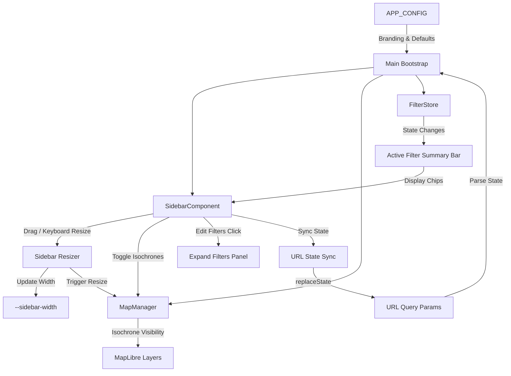

# Requirements

### Overview & Goals
This project implements the 5 newly requested features and enhancements from `DESIRED_FEATURES.md` for ConferenceWalker:
1. **Fully Resizable Left Sidebar**: Allow users to dynamically drag and resize the sidebar width on desktop viewports, persisting the preference in `localStorage`, maintaining responsive constraints, and triggering MapLibre canvas resizing smoothly.
2. **Prominent Filter Navigation & Active Filter Summary**: Add a prominent filter bar and active filter summary directly below the Explore/Saved tabs when filters are collapsed, enabling users to see active filters at a glance and jump straight back into filter editing with one click.
3. **Isochrone Walking Distance Toggle & URL/State Sync**: Restore the ability to toggle walking distance isochrone zones on/off, with configuration defaults, persistent `localStorage` preference, MapLibre layer visibility management, and bidirectional URL parameter syncing (`isochrones=true/false`).
4. **Configurable Conference Subtitle & Address Pin Text**: Provide configuration options in `ConferenceWalkerConfig` allowing organizers to specify custom text for the top-left sidebar subtitle and the on-map conference center pin label.
5. **Configurable Welcome Message / Banner**: Add a configuration option to render custom HTML/text in the sidebar to greet attendees with event information, instructions, or announcements.

### Scope
- **In Scope**:
  - Updating `ConferenceWalkerConfig` in `src/config.ts` with `conferenceSubtitle`, `conferencePinLabel`, `welcomeHtml`, and `showIsochronesByDefault`.
  - Adding a draggable, accessible resize handle (`#sidebar-resizer`) with pointer and keyboard controls, min/max width limits, and `localStorage` storage (`cw_sidebar_width`).
  - Adding an active filter summary banner in `src/ui/sidebar.ts` with prominent "Edit Filters" action and quick filter tag indicators.
  - Adding isochrone visibility management (`setIsochronesVisible`) in `src/map/mapManager.ts`, a toggle in the Settings panel / quick toggles, `localStorage` persistence, and URL parameter syncing in `src/utils/urlState.ts`.
  - Rendering configurable welcome HTML/text in `src/ui/sidebar.ts`.
  - Updating unit tests (`tests/sidebar.test.ts`, `tests/mapManager.test.ts`, `tests/urlState.test.ts`, `tests/settings.test.ts`, `tests/a11y.test.ts`) and E2E flow tests.
  - Updating `FEATURES.md`, `documentation/user_guide.md`, `documentation/developer_guide.md`, and generating a summary report.
- **Out of Scope**:
  - Modifying the Python data preprocessing pipeline or GeoJSON generation (the features operate strictly on the frontend and configuration layers).

### User Stories
- **As an attendee on a widescreen monitor or tablet**, I want to drag the sidebar edge to make it wider or narrower so that I can comfortably view more POI details or more map area simultaneously.
- **As an attendee browsing the Explore list**, I want to see an active filter summary and a prominent "Edit Filters" button so that I know why certain POIs are displayed and can quickly modify my filter criteria.
- **As an attendee**, I want to toggle walking isochrone zones on or off according to my visual preference, and have this setting preserved across reloads and shared links.
- **As an event organizer**, I want to configure custom conference branding (pin label, header subtitle, and a rich welcome banner) so attendees see clear event-specific messaging upon opening the application.
- **As an assistive technology user**, I want full keyboard accessibility (e.g. arrow keys for resizing, visible focus indicators, ARIA live updates) across all newly added controls.

### Functional Requirements
- **FR-1 (Resizable Sidebar)**:
  - Add a vertical drag handle on the right edge of the desktop sidebar.
  - Support pointer/mouse drag events with smooth updates, clamping width between 300px and 700px (or up to 70% viewport width).
  - Support keyboard resizing via Left/Right arrow keys with `role="separator"`, `aria-orientation="vertical"`, and `aria-valuenow`.
  - Persist sidebar width to `localStorage.getItem('cw_sidebar_width')` and restore on application load.
  - Trigger `mapManager.resize()` during and at the conclusion of resize events to avoid canvas distortion.
- **FR-2 (Prominent Filter Button & Active Filter Summary)**:
  - When in list view (filters collapsed), display a prominent filter bar below the Explore/Saved tabs with an "🎛️ Edit Filters" button and an active filter summary (e.g. active categories, walk distance, open now status, or "Showing all venues").
  - Provide quick-clear chips for active filters and ensure clicking anywhere on the filter summary opens the filter editor.
- **FR-3 (Isochrone Toggle & URL Sync)**:
  - Add `showIsochronesByDefault` (default `true`) to `APP_CONFIG`.
  - Add `setIsochronesVisible(visible: boolean)` to `MapManager` that updates MapLibre layout visibility (`isochrones-fill`, `isochrones-line`, `isochrones-labels`).
  - Add a toggle checkbox in Settings ("Show walking distance zones") and support `isochrones=true|false` query parameter in `src/utils/urlState.ts`.
  - Persist setting in `localStorage` (`cw_show_isochrones`).
- **FR-4 (Configurable Pin Label & Conference Subtitle)**:
  - In `ConferenceWalkerConfig`, support `conferenceSubtitle?: string`, `conferencePinLabel?: string`, and `conferencePinTitle?: string`.
  - Display `APP_CONFIG.conferenceSubtitle` (falling back to `region.name.split(',')[0]`) below the title in the sidebar header.
  - Display `APP_CONFIG.conferencePinLabel` on the on-map center pin marker.
- **FR-5 (Configurable Welcome Banner)**:
  - In `ConferenceWalkerConfig`, support `welcomeHtml?: string`.
  - Render the configured welcome content at the top of the sidebar with an optional dismiss button (storing dismissal in `localStorage`).

### Non-Functional Requirements
- **Accessibility (a11y)**: WCAG 2.1 AA compliant, ARIA attributes for resizer and filter banners, keyboard accessible controls, high contrast focus states.
- **Responsiveness**: Disable sidebar drag resizing gracefully on mobile viewports (where bottom drawer behavior applies) while maintaining full functionality on tablet and desktop.
- **Performance**: Debounce or throttle resize event triggers using `requestAnimationFrame` to ensure 60fps layout adjustments.

# Technical Design

### Current Implementation
- `src/config.ts`: Contains `APP_CONFIG` with default categories, filter expansion, Overture exclusion, and default saved POIs, but lacks settings for isochrones, branding text, or welcome HTML.
- `src/ui/sidebar.ts`: Renders tabs, search input, filter sections, and POI list. When filters are collapsed, only the header and POI list are visible without an active filter summary banner.
- `src/map/mapManager.ts`: Renders `isochrones-fill`, `isochrones-line`, and `isochrones-labels` unconditionally during `renderIsochrones()`, without dynamic visibility switching or state retention across basemap swaps.
- `src/utils/urlState.ts`: Serializes filter attributes, tabs, selected POI, and basemap style, but lacks `isochrones` parameter parsing and serialization.
- `src/style.css`: Uses fixed CSS variable `--sidebar-width: 400px;` without resizer element styling or active filter summary bar styling.

### Key Decisions
1. **Sidebar Drag Resizing Architecture**: Use a dedicated `#sidebar-resizer` element with pointer events (`pointerdown`, `pointermove`, `pointerup`, `setPointerCapture`) and `requestAnimationFrame` throttling. Update the CSS variable `--sidebar-width` on `:root` or `#sidebar-container` inline style and call `mapManager.resize()` to keep the MapLibre viewport synchronized.
2. **Prominent Filter Bar Placement**: Position the active filter summary bar directly below the `.tabs-bar` container in `SidebarComponent` when `isFiltersOpen` is false. Display chips for active categories, walk time limits, and dietary options with a prominent "🎛️ Edit Filters" CTA button.
3. **Isochrone Visibility Lifecycle**: Store `isochronesVisible: boolean` in `MapManager`. Update `map.setLayoutProperty()` for `isochrones-fill`, `isochrones-line`, and `isochrones-labels`. Re-apply the stored visibility state on basemap style changes without needing to reload or refetch GeoJSON data.
4. **Configuration & Custom Branding Fallbacks**: Implement backward-compatible defaults in `src/config.ts` so if `conferenceSubtitle`, `conferencePinLabel`, or `welcomeHtml` are omitted, the application seamlessly falls back to `region.name` and default layout cleanly.

### Proposed Changes
- **`src/config.ts`**:
  - Add `conferenceSubtitle?: string;`, `conferencePinLabel?: string;`, `conferencePinTitle?: string;`, `welcomeHtml?: string;`, and `showIsochronesByDefault?: boolean;` to `ConferenceWalkerConfig`.
- **`src/map/mapManager.ts`**:
  - Add `private isochronesVisible = true;`.
  - Implement `public setIsochronesVisible(visible: boolean): void`.
  - Update `renderIsochrones()` to accept optional custom label and title for the conference marker pin.
  - Re-apply `isochronesVisible` state inside `setBasemapStyle()`.
- **`src/utils/urlState.ts`**:
  - Add `showIsochrones: boolean | null` to `ParsedUrlState` and `UrlSyncOptions`.
  - Parse `isochrones` and `show_isochrones` query parameters.
  - Serialize `isochrones=false` when disabled.
- **`src/ui/sidebar.ts`**:
  - Add resizer DOM element, pointer event handlers, keyboard listener, and `localStorage` persistence.
  - Add active filter summary component rendering below tabs when filters are collapsed.
  - Add welcome banner rendering when `APP_CONFIG.welcomeHtml` is provided.
  - Add isochrone toggle switch to Settings panel and connect with `MapManager`.
- **`src/style.css`**:
  - Add styling for `.sidebar-resizer`, `.active-filter-summary-bar`, `.filter-chip-summary`, `.welcome-banner-card`, and mobile responsive overrides.

### Architecture Diagram

# Testing

### Validation Approach
Automated tests will cover unit tests, integration tests, accessibility verification, and end-to-end user flows.

### Key Scenarios
1. **Sidebar Drag & Keyboard Resizing**:
   - Verify pointer drag expands and contracts sidebar width within clamped bounds (300px to 700px).
   - Verify Left and Right arrow keys adjust width with appropriate `aria-valuenow` updates.
   - Verify width persists across page reloads via `localStorage`.
2. **Prominent Filter Bar & Active Filter Summary**:
   - Verify that when filters are collapsed, the active filter summary bar appears below the tabs.
   - Verify that clicking "Edit Filters" or filter summary chips re-opens the filter panel.
   - Verify that active categories, walk time limits, and dietary restrictions are accurately summarized in the banner.
3. **Isochrone Toggle & URL Sync**:
   - Verify toggling isochrones off hides `isochrones-fill`, `isochrones-line`, and `isochrones-labels` layers on the map.
   - Verify isochrone visibility is preserved across basemap theme switches (Positron, Bright, Liberty).
   - Verify `isochrones=false` is serialized into the URL bar and hydrated on page load.
4. **Configurable Pin Label & Subtitle**:
   - Verify that setting `conferenceSubtitle` and `conferencePinLabel` updates the sidebar header and map pin accordingly.
   - Verify graceful fallback to `region.name` when configuration options are omitted.
5. **Configurable Welcome HTML**:
   - Verify that welcome HTML is rendered in the sidebar when configured in `APP_CONFIG`.
   - Verify dismiss functionality hides the banner and stores state in `localStorage`.
6. **Accessibility & Responsiveness**:
   - Verify WCAG 2.1 AA compliance and visible `:focus-visible` styling for new controls.
   - Verify that sidebar drag resizing is disabled gracefully on mobile viewports (<=768px).

### Test Changes
- `tests/sidebar.test.ts`: Add test cases for sidebar resizing, active filter summary rendering, welcome banner, and filter expand triggers.
- `tests/mapManager.test.ts`: Add test cases for `setIsochronesVisible()`, custom pin labels, and style reload layer retention.
- `tests/urlState.test.ts`: Add test cases for `isochrones` query parameter parsing and serialization.
- `tests/settings.test.ts`: Add test cases for isochrone toggle persistence and interaction.
- `tests/a11y.test.ts`: Add accessibility checks for sidebar resizer handle and filter summary banner.

# Delivery Steps

### ✓ Step 1: Implement configurable branding, welcome banner, and isochrone visibility toggle
Add conference subtitle, pin label, welcome HTML configuration, and isochrone toggle with URL and storage sync.

- Add `conferenceSubtitle`, `conferencePinLabel`, `conferencePinTitle`, `welcomeHtml`, and `showIsochronesByDefault` to `ConferenceWalkerConfig` in `src/config.ts`.
- Update `MapManager` in `src/map/mapManager.ts` with `setIsochronesVisible(visible: boolean)` to toggle layer visibility for `isochrones-fill`, `isochrones-line`, and `isochrones-labels`, retaining state during basemap switches.
- Update `src/map/mapManager.ts` to use `APP_CONFIG.conferencePinLabel` and `conferencePinTitle` for the conference marker pin.
- Update `src/utils/urlState.ts` to parse and serialize `isochrones=true|false` query parameters.
- Add an Isochrones toggle in `src/ui/sidebar.ts` Settings panel and wire `localStorage` persistence (`cw_show_isochrones`).
- Render `APP_CONFIG.welcomeHtml` in `src/ui/sidebar.ts` as a dismissible welcome banner card.

### ✓ Step 2: Implement resizable sidebar and prominent filter navigation with active filter summary
Implement drag-and-drop / keyboard sidebar resizing and active filter summary banner below Explore and Saved tabs.

- Add a draggable resizer handle (`#sidebar-resizer`) with pointer event listeners, clamping width between 300px and 700px (and up to 70vw).
- Add keyboard accessibility to the resizer handle (`role="separator"`, `aria-orientation="vertical"`, `aria-valuenow`, `aria-valuemin`, `aria-valuemax`, handling `ArrowLeft` / `ArrowRight` / `Home` / `End`).
- Persist resized width in `localStorage` (`cw_sidebar_width`) and trigger `mapManager.resize()` on adjustments.
- Add an active filter summary bar in `src/ui/sidebar.ts` below `.tabs-bar` when filters are collapsed, displaying active filter chips and a prominent "🎛️ Edit Filters" CTA button.
- Add CSS styling in `src/style.css` for the resizer handle, active filter summary bar, filter chips, and welcome banner card.

### ✓ Step 3: Add unit, integration, and accessibility tests for new features
Create comprehensive automated test suites verifying all newly implemented capabilities.

- Add test suites in `tests/sidebar.test.ts` verifying sidebar resize events, keyboard navigation, welcome banner dismissal, and filter summary interactions.
- Add test suites in `tests/mapManager.test.ts` verifying isochrone visibility toggling, custom marker labels, and basemap style reloading.
- Add test suites in `tests/urlState.test.ts` verifying `isochrones` query parameter synchronization.
- Add test suites in `tests/settings.test.ts` and `tests/a11y.test.ts` verifying setting persistence, ARIA attributes, and keyboard accessibility.
- Execute full test suites (`npm test` and Python pytest) to ensure all tests pass cleanly.

### ✓ Step 4: Update documentation, feature registry, and generate final report
Document the new features in user/developer guides, register them in FEATURES.md, and record completed work.

- Update `FEATURES.md` with entries for resizable sidebar, active filter summary bar, isochrone toggle, configurable branding, and welcome banner.
- Update `documentation/user_guide.md` with instructions for resizing the sidebar, using the filter summary bar, and toggling isochrones.
- Update `documentation/developer_guide.md` detailing new configuration parameters, URL parameters, and DOM component APIs.
- Create a summary report in `.junie/reports/summary_<date>_<time>.md` documenting the prompt, architecture decisions, and test results.