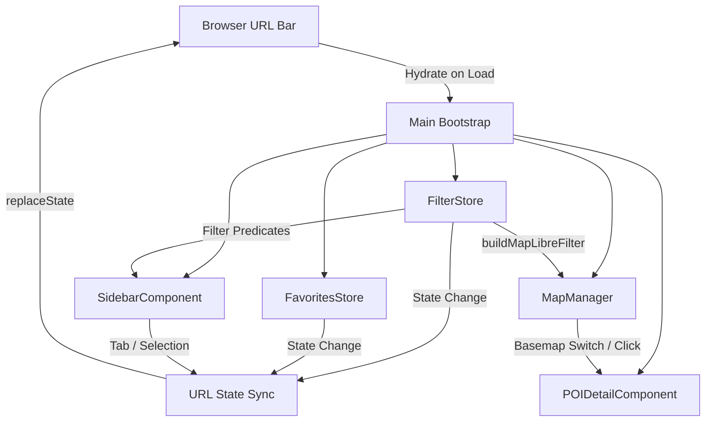

# Requirements

### Overview & Goals
This project implements the 8 feature requests and bug fixes specified in `DESIRED_FEATURES.md` for ConferenceWalker:
1. **URL-Triggered Saved POI Export Mode**: Enable an administrative URL mode (`?export_saved=true`) to download saved/starred POIs as a configuration file for default saved venues.
2. **Configurable Default Saved POIs & Startup Saved Mode**: Add configuration settings allowing the application to launch with predefined saved POIs and automatically enter Saved mode by default, while allowing users to toggle to the full Explore view.
3. **Fix Overture Exclusion Default Configuration Bug**: Fix the state initialization and map layer lifecycle bug where the default exclusion of Overture-only places was ignored until manually toggled in the UI.
4. **Bidirectional URL Deep Linking & State Synchronization**: Synchronize active filters, search query, selected/expanded POI, active tab, and modes with the browser URL bar so users can deep link directly to specific views and POIs.
5. **OpenStreetMap Mural & Public Art Extraction**: Enhance the OSM data ingestion taxonomy to ensure wall murals (`artwork_type=mural`, `artwork_type=wall_painting`, `wall=mural`), public art (`man_made=artwork`, `amenity=public_art`), and street art are classified under `attraction_art`.
6. **Nearest POI per Enabled Category Mode**: Provide a filter mode (linkable via URL) that displays only the single nearest matching POI for each enabled category based on current filter criteria (e.g. nearest vegan restaurant).
7. **Accessibility (a11y) Audit & E2E Testing**: Audit and remediate accessibility issues across all UI components (keyboard navigation, ARIA landmarks, focus management, color contrast), and add automated end-to-end tests using Playwright/Cypress to prevent regressions.
8. **OpenFreeMap Basemap Switcher**: Add a style selector supporting multiple OpenFreeMap vector styles (Positron, Bright, Liberty).

### Scope
- **In Scope**:
  - Fixing `FilterStore` and `MapManager` filter application lifecycle.
  - Adding URL state serialization/deserialization with `history.replaceState`.
  - Adding Saved POI export tool and default favorites configuration options.
  - Extending OSM tag classification rules in `pipeline/categories.py`.
  - Implementing nearest-per-category filtering algorithm.
  - Adding OpenFreeMap basemap switcher (Positron, Bright, Liberty) in `MapManager` and UI.
  - Remedying accessibility issues and adding automated E2E tests.
  - Updating `FEATURES.md`, `documentation/user_guide.md`, `documentation/developer_guide.md`, and `.junie/reports/`.
- **Out of Scope**:
  - Modifying the underlying duckdb/spatial remote query engine architecture.
  - Introducing server-side backend persistence (all state remains client-side and URL-driven).

### User Stories
- **As an event organizer**, I want to curate a list of recommended POIs, export them via a URL export mode, and configure them as default saved places so attendees see recommended venues upon opening the app.
- **As an attendee**, I want to share a link to a specific restaurant or filtered view with colleagues, so they see the exact same venue card and map location when opening the link.
- **As an attendee with dietary preferences**, I want to toggle "Nearest Option per Category" to quickly see the closest vegan restaurant, closest coffee shop, and closest pharmacy without browsing hundreds of pins.
- **As an attendee using assistive technology**, I want full keyboard accessibility and screen reader support so that I can explore conference venues seamlessly.
- **As an attendee**, I want to switch between map styles (Positron, Bright, Liberty) depending on my visual preference or ambient lighting conditions.

# Technical Design

### Current Implementation
- `src/state/filterState.ts`: Manages multi-dimensional filtering, but `detectInitialExcludeOverture()` contains faulty `localStorage` boolean coercion, causing default configuration flags to behave inconsistently until toggled.
- `src/map/mapManager.ts`: MapLibre GL engine manages layers; `applyFilter()` drops filter expressions if called before `map.on('load')` fires because `activeFilter` is not persisted in manager state.
- `src/config.ts`: Contains `APP_CONFIG` with `defaultCategories`, `filtersExpandedByDefault`, and `excludeOvertureOnlyByDefault`, but lacks options for default saved POIs or startup saved mode.
- `pipeline/categories.py`: `classify_osm_tags()` maps OSM tags to 10 categories, but lacks explicit matching for murals (`artwork_type=mural`, `artwork_type=wall_painting`, `wall=mural`) and `man_made=artwork`.
- `src/ui/sidebar.ts`: Renders filter controls, search, and POI cards, but lacks URL synchronization, nearest-only toggle, basemap switcher, and saved export actions.

### Key Decisions
1. **URL State Synchronization**: Use `URLSearchParams` with `window.history.replaceState()` to update the URL dynamically without triggering page reloads. Parse query params during application bootstrap to hydrate `FilterStore`, `FavoritesStore`, `MapManager`, and `POIDetailComponent`.
2. **Nearest-per-Category Computation**: Perform nearest filtering in `FilterStore.getMatchingIds()` by first computing all POIs matching standard filters, grouping them by `category`, calculating Haversine distance from the conference center, and retaining only the POI with minimal distance in each category group.
3. **Basemap Switching without Layer Loss**: Implement `MapManager.setBasemapStyle(styleUrl)` by updating the base style and re-attaching GeoJSON sources (`isochrones-source`, `pois-source`), layers (`isochrones-fill`, `pois-circle`, `pois-symbol`), and active filters upon the `style.load` event.
4. **End-to-End & A11y Testing**: Use Playwright with `@axe-core/playwright` to run headless browser tests, automated WCAG 2.1 AA audits, and cross-feature interaction testing.

### Proposed Changes
- **Overture Bug Fix & Map Filter Lifecycle**:
  - Refactor `detectInitialExcludeOverture()` in `src/state/filterState.ts` to correctly handle `null`, `'true'`, and `'false'` from `localStorage`, and check query parameter `exclude_overture`.
  - Store `private activeFilter: any[] | null = null;` in `MapManager` and re-apply it inside `map.on('load')` and after any layer creation.
- **Saved POI Export & Default Saved Startup**:
  - Add `src/utils/exportSaved.ts` to export saved POI IDs or features as `default_saved_pois.json`.
  - Add `defaultSavedPois?: string[]` and `startWithSavedOnlyByDefault?: boolean` to `ConferenceWalkerConfig` in `src/config.ts`.
  - Seed `FavoritesStore` with default saved POIs on first load and configure `SidebarComponent` to select the Saved tab when enabled.
- **URL State Synchronization**:
  - Implement `src/utils/urlState.ts` with `serializeStateToUrl(state, selectedPoiId, activeTab, basemap)` and `deserializeUrlToState()`.
  - Bind subscriptions in `src/main.ts` so filter modifications, tab switches, and POI card clicks update the URL bar in real time.
- **OSM Murals and Public Art**:
  - Update `classify_osm_tags()` in `pipeline/categories.py` to classify `artwork_type=mural`, `artwork_type=wall_painting`, `man_made=artwork`, `wall=mural`, and `amenity=public_art` as `CATEGORY_ATTRACTION_ART`.
- **Nearest Option per Category Mode**:
  - Add `nearestOnly: boolean` to `FilterState` and a checkbox in `SidebarComponent`.
  - Filter down candidate POIs to the closest item per category relative to `region.center`.
- **OpenFreeMap Basemap Switcher**:
  - Define styles (`Positron`, `Bright`, `Liberty`) in `src/map/mapStyles.ts`.
  - Implement `setBasemapStyle()` in `MapManager` and add switcher UI in `SidebarComponent` (Settings drawer) or map controls.
- **Accessibility Improvements**:
  - Add ARIA attributes (`aria-live="polite"` for result counts, `aria-expanded`, `aria-selected`), manage modal focus trapping in `POIDetailComponent`, enable keyboard navigation for category chips and venue cards, and ensure high-contrast `:focus-visible` styling.

### Architecture Diagram

# Testing

### Validation Approach
Automated testing will cover unit tests, pipeline tests, and headless browser end-to-end (E2E) tests with automated accessibility auditing.

### Key Scenarios
1. **Overture Exclusion Default**:
   - Verify that when `excludeOvertureOnlyByDefault: true` is configured, Overture-only POIs are excluded on initial page load in both the sidebar listing and map layers without requiring manual toggling.
   - Verify that changing the setting in the UI persists correctly to `localStorage` and URL parameters.
2. **Saved POIs Export Mode**:
   - Load application with `?export_saved=true` and verify the export button appears.
   - Verify that clicking export downloads a valid JSON payload containing the currently starred POI IDs.
3. **Default Saved POIs Startup**:
   - Configure `defaultSavedPois` and `startWithSavedOnlyByDefault: true` in `APP_CONFIG`.
   - Verify that on initial launch, the application opens in Saved mode showing only those default venues, with the ability to switch to Explore mode to see all venues.
4. **URL Deep Linking**:
   - Modify filters (e.g. category `restaurant`, cuisine `vegan`, walk time `10`), select a POI, and verify the URL updates.
   - Reload from the generated URL and verify that all filters, the active tab, and the selected POI detail sheet are restored identically.
5. **Nearest per Category Mode**:
   - Enable "Nearest per Category" with restaurant (vegan cuisine) and coffee_tea enabled.
   - Verify that exactly one nearest vegan restaurant and one nearest coffee shop are displayed.
6. **Basemap Switcher**:
   - Switch between Positron, Bright, and Liberty styles; verify that isochrone walkshed layers, POI markers, and active filters persist cleanly across style reloads.
7. **Accessibility (a11y) & E2E Testing**:
   - Run automated axe-core audits via Playwright/Cypress; verify 0 WCAG 2.1 AA violations.
   - Verify keyboard navigation: `Tab` through all interactive elements, `Enter`/`Space` to activate chips/cards, `Escape` to close modal drawers, and verify visible focus indicators.
8. **OSM Mural Categorization**:
   - Run pipeline tests with sample OSM features tagged with `tourism=artwork`, `artwork_type=mural`, `artwork_type=wall_painting`, and `man_made=artwork`; verify they classify as `attraction_art`.

### Test Changes
- `tests/filters.test.ts`: Add test suites for nearest-per-category filtering and Overture exclusion defaults.
- `tests/settings.test.ts`: Update and expand settings tests for Overture persistence, basemap switching, and debug modes.
- `tests/urlState.test.ts`: Add comprehensive test suite for URL serialization, deserialization, and deep link restoration.
- `tests/favorites.test.ts`: Add test cases for default saved POI seeding and export functionality.
- `tests/test_pipeline.py`: Add test cases for OSM wall murals and public art classification.
- `tests/e2e/`: Add Playwright E2E and axe-core accessibility tests.

# Delivery Steps

### ✓ Step 1: Fix Overture exclusion, map filter lifecycle, and OSM mural classification
Fix the filter state initialization and map layer filter timing bugs, and enhance OpenStreetMap classification for public art and murals.

- Fix `FilterStore.detectInitialExcludeOverture()` in `src/state/filterState.ts` to properly parse `localStorage` (`'true'` vs `'false'` vs `null`) and respect `APP_CONFIG.excludeOvertureOnlyByDefault`.
- Update `MapManager` in `src/map/mapManager.ts` to retain `activeFilter` in state and apply it during `map.on('load')` and POI layer initialization so initial filter rules are never dropped on startup.
- Update `classify_osm_tags()` in `pipeline/categories.py` to classify murals (`artwork_type=mural`, `artwork_type=wall_painting`, `wall=mural`), public art (`man_made=artwork`, `amenity=public_art`), and street art under `CATEGORY_ATTRACTION_ART`.
- Add unit tests in `tests/filters.test.ts`, `tests/settings.test.ts`, and `tests/test_pipeline.py`.

### ✓ Step 2: Implement saved POI export mode and configurable default saved startup
Implement the URL-triggered export tool for saved favorites and configurable default saved POIs on startup.

- Add URL parameter check (`?export_saved=true` / `?export_mode=true`) in `src/state/filterState.ts` and `src/ui/sidebar.ts` to reveal an "Export Saved POIs" action button.
- Implement JSON exporter utility in `src/utils/exportSaved.ts` that packages the current starred POIs into a standardized `default_saved_pois.json` format and triggers a browser download.
- Add configuration parameters (`defaultSavedPois`, `startWithSavedOnlyByDefault`) to `src/config.ts` and `ConferenceWalkerConfig`.
- Update `FavoritesStore` in `src/state/favorites.ts` to initialize and merge default saved POIs when localStorage is empty.
- Configure `SidebarComponent` and `FilterStore` to open in Saved mode (`tab=favorites` / `favoritesOnly: true`) when `startWithSavedOnlyByDefault` is enabled, allowing attendees to toggle back to Explore view.
- Add unit tests in `tests/favorites.test.ts` and `tests/sidebar.test.ts`.

### ✓ Step 3: Implement nearest POI mode, basemap switcher, and bidirectional URL deep linking
Implement the nearest-per-category filter mode, OpenFreeMap basemap switcher, and comprehensive URL state synchronization.

- Add `nearestOnly: boolean` to `FilterState` and update `FilterStore.matches()` / `getMatchingIds()` in `src/state/filterState.ts` to group matching candidates by category and select only the nearest POI to the conference center per category.
- Add "Nearest per category" toggle in `src/ui/sidebar.ts` quick toggles section.
- Add OpenFreeMap style definitions (`Positron`, `Bright`, `Liberty`) in `src/map/mapStyles.ts` and implement `setBasemapStyle(styleKey)` in `src/map/mapManager.ts` to swap styles while preserving isochrone layers, POI markers, and filter expressions.
- Add Basemap Switcher UI in `src/ui/sidebar.ts` (Settings panel and map controls).
- Create `src/utils/urlState.ts` for bidirectional synchronization of UI state (selected POI, category filters, walk times, cuisines, open now, search query, active tab, nearest mode, basemap, overture exclusion) using `history.replaceState`.
- Add unit tests in `tests/filters.test.ts`, `tests/mapManager.test.ts`, and `tests/urlState.test.ts`.

### ✓ Step 4: Conduct accessibility audit, fix a11y issues, and add E2E test suite
Perform an accessibility audit across all UI components, resolve identified issues, and add end-to-end tests to prevent regressions.

- Conduct an accessibility audit checking WCAG 2.1 AA compliance across all components (`SidebarComponent`, `POIDetailComponent`, filter controls, category chips, map popups, settings drawer).
- Ensure semantic HTML, proper ARIA landmark roles (`role="main"`, `role="region"`, `role="dialog"`, `role="tablist"`), focus traps and `Escape` key handlers for modals, and high-contrast visible focus indicators (`:focus-visible`).
- Install and configure Playwright / Cypress for browser-based automated testing.
- Add E2E tests and automated axe-core accessibility checks in `tests/e2e/` verifying deep linking, filtering, POI detail modal interactions, basemap switching, and keyboard navigation.

### ✓ Step 5: Update documentation, feature registry, and generate final report
Update feature registry, developer/user documentation, and generate a summary report.

- Update `FEATURES.md` with detailed entries for all 8 new and improved capabilities.
- Update `documentation/user_guide.md` and `documentation/developer_guide.md` with instructions for URL deep linking, export mode, nearest filter, basemap switcher, and configuration options.
- Create a summary report in `.junie/reports/summary_<date>_<time>.md` detailing prompt understanding, changes implemented, and test results.
- Run complete test suite (`npm test`, E2E tests, and pytest for pipeline) to verify all tests pass.