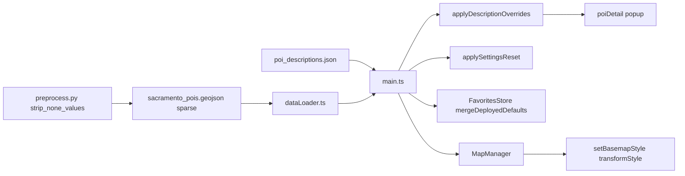

# Requirements

### Overview & Goals
This is a batch of five independent improvements to the ConferenceWalker web map:

1. **Icon-only header buttons** — the `Settings` and `Filters` buttons in the sidebar header overflow the content area; shrink them to icon-only buttons with accessible labels.
2. **Selective localStorage reset with protected favorites** — let a new deploy reset *some* settings on browsers that already opened the app, while **never** overwriting saved/starred places, and merge newly deployed default saved places into each user's existing stars.
3. **POI description overrides** — a new file keyed by OSM ID supplying descriptions that always take priority over the POI's own description in the detail popup.
4. **Sparse JSON data files** — the preprocessing pipeline drops null/None keys to shrink output; the front-end tolerates missing (`undefined`) keys as well as explicit `null`.
5. **Basemap switch no longer drops POIs** — switching the basemap must keep POIs, isochrones, filters, favorites, and selection on the map without a page refresh.

### Scope
**In scope**
- `src/ui/sidebar.ts` / `src/style.css`: render the header Settings/Filters buttons as icon-only with `aria-label`/`title`, and stop them from overflowing.
- `src/state/favorites.ts`, `src/config.ts`, `src/main.ts`: a config-driven settings-reset version and an "add only new" merge of default saved places that protects stars.
- New `public/data/poi_descriptions.json` (object keyed by OSM ID), a loader for it, and override logic feeding the POI detail popup.
- `pipeline/preprocess.py`: omit null/None keys from emitted POI and region JSON (indentation preserved); `src/services/dataLoader.ts` and consumers handle missing keys.
- `src/map/mapManager.ts`: fix the basemap switch using MapLibre `transformStyle` carry-over.
- Tests (Vitest/jsdom + Python pytest), new Playwright smoke tests, `FEATURES.md`, `documentation/`, and a `.junie/reports` summary.

**Out of scope**
- Redesigning the Settings drawer contents or the filter panel internals.
- Changing isochrone styling or the existing contour-label behavior.
- A general settings-schema/migration framework beyond the version-gated reset described here.

### User Stories
- As an attendee on a narrow screen, I want the header buttons to fit without overflowing so the header looks clean and nothing is clipped.
- As a returning attendee, I want a new deployment to be able to refresh default settings without ever losing the places I starred.
- As an organizer, when I deploy new recommended places, I want them added to attendees' saved lists without removing the places they already saved.
- As an attendee reading a venue, I want the organizer-curated description shown when one exists, so I see the most relevant blurb.
- As an attendee, I want to switch the basemap and still see all POIs and zones, without reloading the page.

### Functional Requirements
- **FR-1 (Icon buttons):** The header `Settings` (⚙️) and `Filters` (🎛️ / ✕ when open) buttons show only their icon, carry an accurate `aria-label` and `title`, keep a visible `:focus-visible` outline, meet the ≥44px touch-target guideline, and never overflow the header row on mobile, tablet, or desktop widths.
- **FR-2 (Settings reset):** A number, `APP_CONFIG.settingsResetVersion` (default `0`), is compared with the stored `cw_settings_reset_version`. When the config version is higher, the app clears an explicit allowlist of settings keys once and records the new version. Saved places (`conference_walker_favorites_v1`) and the seen-defaults list are never cleared. URL parameters still take priority over everything.
- **FR-3 (Favorites merge):** On load, any `APP_CONFIG.defaultSavedPois` ID the browser has not previously received is added to the user's stars; already-seen defaults are not re-added, so a user's un-starring sticks. The set of seen defaults is persisted separately from the stars.
- **FR-4 (Description override):** `public/data/poi_descriptions.json` maps OSM ID → description string. When a POI's OSM ID has an entry, that description is shown in the detail popup instead of any pipeline/export description. POIs without an override keep their existing description.
- **FR-5 (Sparse JSON):** The pipeline drops keys whose value is `None` from emitted POI feature properties and region metadata, and keeps `indent=2`. Values that are falsy but not null (`0`, `""`, `[]`, `false`) are kept. The front end treats a missing key exactly like an explicit `null` everywhere it reads POI or region fields.
- **FR-6 (Basemap persistence):** After switching basemaps via the Settings selector, all POI markers/circles, isochrone layers, active filters, favorites highlights, and the selected-POI ring remain, with no page refresh and no empty-map flash of lost POIs.

### Non-Functional Requirements
- **Accessibility:** Icon-only buttons remain fully operable and announced by screen readers via `aria-label`; focus order and `:focus-visible` styling are preserved; contrast of icon glyphs meets WCAG AA.
- **Responsive:** Header buttons and all affected UI adapt to mobile, tablet, and desktop and to orientation/resize changes.
- **Robustness:** All new storage and data-loading paths degrade gracefully when `localStorage` is unavailable (private browsing) or when `poi_descriptions.json` is missing/malformed.
- **Backward compatibility:** Existing non-sparse data files and existing stored favorites continue to work unchanged.

# Technical Design

### Current Implementation
- **Header buttons:** `src/ui/sidebar.ts` `render()` (lines ~321–343) emits `#btn-toggle-settings` and `#btn-toggle-filters`, each as an `<span class="icon">` plus a text `<span>` (`Settings`, `Filters`/`Close`). `src/style.css` styles `.btn-toggle-settings, .btn-toggle-filters` (lines ~210–237) with `padding: 6px 10px; gap: 6px;` and `.header-actions` with `gap: 6px`. The text labels widen the row and can overflow. The buttons already have `aria-label` on Settings and a dynamic one on Filters.
- **Favorites:** `src/state/favorites.ts` seeds from `APP_CONFIG.defaultSavedPois` **only when `localStorage` has no stored list**; returning browsers never receive newly deployed defaults. Key: `conference_walker_favorites_v1`.
- **Settings storage:** scattered keys read/written in `src/main.ts`, `src/ui/sidebar.ts`, `src/state/debugState.ts`, `src/state/filterState.ts`: `cw_show_isochrones`, `cw_icon_size`, `cw_sidebar_width`, `cw_welcome_dismissed`, `conference_walker_exclude_overture`, `conference_walker_debug`. There is no version/reset mechanism.
- **Descriptions:** `pipeline/preprocess.py` extracts `description` from OSM tags; `src/services/dataLoader.ts` parses `rawProps.description`; `src/ui/poiDetail.ts` (lines ~191–199) renders `props.description` in the detail sheet. `src/utils/exportSaved.ts` `mergeExportedVenues` already merges descriptions from an export payload (without overwriting existing ones).
- **Data shape:** `pipeline/preprocess.py` `convert_pois_to_geojson` (lines ~493–529) and `export_region_summary` emit every key even when `None`; the POI file is ~867 `"description": null` lines today. `dataLoader.parseAndValidatePOIs` already uses `rawProps.x ? ... : null`, so it tolerates missing keys, but this must be verified field-by-field.
- **Basemap switch:** `MapManager.setBasemapStyle()` (lines ~558–609) calls `map.setStyle(url)` then listens for `styledata`/`style.load` and re-runs `renderIsochrones`/`renderPOIs`. In MapLibre 4.7 (`node_modules/maplibre-gl/src/ui/map.ts`), `setStyle` with no options **diffs** the new style in and does **not** fire `style.load`; the diff removes our runtime sources/layers, and `renderPOIs` early-returns if `pois-source` still appears present — so POIs vanish with no way back except refresh.

### Key Decisions
1. **Config-version settings reset (`APP_CONFIG.settingsResetVersion`).** A single bumpable value in `src/config.ts`, compared to stored `cw_settings_reset_version`; visible and reviewable in git (your choice over a build env var). A central `RESETTABLE_SETTINGS_KEYS` list defines exactly what gets cleared, explicitly excluding the favorites key.
2. **"Add only new" favorites merge.** A separate `cw_seen_default_saved_pois` list records which defaults the browser already received; only unseen defaults are added to the stars, so a user's un-star sticks (your choice). Stars themselves are never cleared by the reset.
3. **Description override file keyed by OSM ID (`public/data/poi_descriptions.json`), as an object `{ "<osm_id>": "text" }`** (your choice). It's compact, lookups are O(1), and duplicate keys can't happen. Overrides are applied to the loaded feature collection at startup, so every consumer (the detail sheet and the saved-places export) sees them, and they **always win** over the feature's own description. The file is optional: if it's missing or malformed, the app loads normally.
4. **Sparse JSON by omitting `None` keys, indentation kept** (your choice). A small helper strips `None` values before `json.dump(..., indent=2)`. The front-end standardizes on optional-chaining/`?? null` reads so `undefined` and `null` behave identically.
5. **Basemap fix via `transformStyle` carry-over** (your choice). `setStyle(url, { transformStyle })` copies our sources and layers, with their current filters and paint, into the incoming style in one atomic step, which removes the race. A light check on `idle` re-registers the category icons and re-adds anything missing. `renderPOIs`/`renderIsochrones` become idempotent per layer.
6. **Add Playwright smoke tests** (your choice): new dev dependency `@playwright/test` with a config and specs covering the icon buttons (no overflow, accessible name) and the basemap switch (POIs persist). Existing Vitest/jsdom tests select buttons by ID, so they remain valid.

### Proposed Changes
- **Icon-only header buttons**
  - `src/ui/sidebar.ts` `render()`: remove the text `<span>` from `#btn-toggle-settings` and `#btn-toggle-filters`. Mark the icon spans `aria-hidden="true"`. Keep `aria-expanded`, keep `aria-label="Settings"` and the dynamic `Open filters`/`Close filters` label, add a matching `title` to Filters, and add `aria-controls="settings-panel"` to Settings. IDs stay the same, so the existing Vitest tests that select by ID keep working.
  - `src/style.css`, overflow fix:
    - `.header-main` gets `gap: 8px; min-width: 0`.
    - `.header-brand` gets `flex: 1 1 auto; min-width: 0`; `.brand-text` gets `min-width: 0`.
    - `.brand-title` ellipsizes.
    - `.conference-name`'s fixed `max-width: 220px` becomes `100%`.
    - `.header-actions` gets `flex-shrink: 0`.
  - `src/style.css`, square icon buttons: 44×44px with `padding: 0; justify-content: center; font-size: 1.25rem`, growing to 48×48px inside the existing `@media (max-width: 768px)` block to keep the ≥48px touch-target claim in `FEATURES.md`. Hover, active and global `:focus-visible` styles are unchanged.

- **Settings reset**: new `src/state/appStorage.ts`.
  - `RESETTABLE_SETTINGS_KEYS`: the six settings keys listed above.
  - `PROTECTED_STORAGE_KEYS`: the favorites key and `cw_seen_default_saved_pois`.
  - `applySettingsReset(targetVersion)`: if the config version is higher than the stored `cw_settings_reset_version` (missing counts as `0`), remove each resettable key and store the new version. With the default `0`, this deploy resets nobody.
  - Every `localStorage` access is wrapped in try/catch.
  - `src/config.ts`: add `settingsResetVersion?: number` (default `0`) with a doc comment.
  - `src/main.ts`: call `applySettingsReset()` first in `bootstrap()`, before `FavoritesStore`, `FilterStore`, `DebugStore` or the sidebar read storage. URL parameters still override afterwards.
- **Saved-places merge** in `src/state/favorites.ts`: export a pure `mergeDeployedDefaultFavorites(stored, seen, defaults)` and use it in `loadFromStorage`:
  - first visit: stars are the defaults, and all defaults are marked seen;
  - returning visit: stars are the stored stars plus defaults not yet seen, and seen becomes seen ∪ defaults;
  - nothing is ever removed from the stored stars;
  - both keys are persisted only when something changed;
  - if the stored stars are corrupted JSON, they're never overwritten on load.
  - `clearFavorites`/`setFavorites` leave the seen list alone, so cleared defaults don't come back. Defaults are still deployed through `APP_CONFIG.defaultSavedPois`, which is the list the export tool produces.
- **Description overrides**
  - New `public/data/poi_descriptions.json`, seeded with `{}`; the format is documented in the developer guide.
  - `src/services/dataLoader.ts`:
    - `parseDescriptionOverrides(raw)`: accepts a plain object; trims values; skips non-string or blank values; normalizes keys by stripping an optional `osm_` prefix.
    - `loadDescriptionOverrides(url)`: on a 404, network or parse error it logs `console.warn` and returns an empty map.
    - `applyDescriptionOverrides(features, overrides)`: returns new feature objects with `description` replaced wherever `osm_id` matches; the input isn't mutated.
  - `src/main.ts`: load the overrides in the same `Promise.all` as the region and POI data, and build `poiCollection` from the overridden features before anything uses them. `mergeExportedVenues` only fills empty descriptions, so overrides keep top priority.
  - `src/ui/poiDetail.ts`: HTML-escape the description (a new `src/utils/escapeHtml.ts`). In `src/style.css`, `.poi-description-text` gets `white-space: pre-line` so line breaks in the override text render. This also fixes the existing unescaped injection of OSM text.
- **Sparse JSON**
  - `pipeline/preprocess.py`: add `strip_none_values(d)`, applied to every feature's `properties` in `convert_pois_to_geojson` and to each isochrone summary dict in `export_region_summary`. `indent=2` stays.
  - Rewrite the current `public/data/sacramento_pois.geojson` once through the same helper, using `.junie/investigations/1_sparsify_poi_geojson.py`, so the shipped file is sparse now; report the size before and after.
  - Front end: `parseAndValidatePOIs` already defaults missing fields. Make the null/undefined handling explicit with `== null` checks and comments, and audit the other readers: `exportSaved.ts` (`mergeExportedVenues`, `generateSavedPoisJson`), the hover tooltip in `mapManager.ts`, `sidebar.ts` and `poiDetail.ts`. Where a raw property is read, use `?? null` or `?? []`.
- **Basemap fix** in `src/map/mapManager.ts`:
  - Export a pure `carryOverAppLayers(previousStyle, nextStyle)`. It copies `isochrones-source`/`pois-source` and their layers, in their original order, into the incoming style, skipping any ID the new style already has.
  - `setBasemapStyle`:
    - if the map isn't loaded yet, just call `setStyle(url)`; the existing `load` handler renders everything;
    - otherwise call `setStyle(url, { transformStyle: carryOverAppLayers })`, then on `idle` (or `style.load` for the full-rebuild fallback) run `restoreAppLayers()`, which re-registers the category images and re-applies filter, favorites and selection;
    - a switch token makes stale handlers from rapid switches no-ops;
    - the old `styledata` listener is removed;
    - the method still returns a Promise.
  - Make `renderPOIs`/`renderIsochrones` idempotent per layer: add each layer only if `!getLayer(id)`, and `setData` when the source exists. The current early return in `renderPOIs` skips missing layers.
  - `src/main.ts`: in dev builds only (`import.meta.env.DEV`), expose `window.__conferenceWalkerMap` so Playwright can inspect the layers.
- **Playwright**
  - Add `@playwright/test` to devDependencies and a `"test:e2e": "playwright test"` script.
  - New `playwright.config.ts`: `testDir: 'tests/e2e'`; `webServer` runs `npm run dev` on port 5173; projects for desktop 1280×800, tablet 820×1180 and mobile Pixel 5. The Chromium browser is installed with `npx playwright install chromium`.
  - Specs are named `*.spec.ts`, so Vitest's existing `tests/**/*.test.ts` include pattern doesn't pick them up and the Vitest config doesn't need to change.

### Data Models / Contracts
```ts
// src/config.ts
settingsResetVersion?: number; // bump to reset non-favorite settings once in returning browsers

// src/state/appStorage.ts
export const SETTINGS_RESET_VERSION_KEY = 'cw_settings_reset_version';
export const RESETTABLE_SETTINGS_KEYS: readonly string[];
export const PROTECTED_STORAGE_KEYS: readonly string[]; // favorites + seen defaults
export function applySettingsReset(targetVersion?: number, storage?: Storage | null): boolean; // true if reset ran

// src/state/favorites.ts
export const SEEN_DEFAULTS_STORAGE_KEY = 'cw_seen_default_saved_pois';
export function mergeDeployedDefaultFavorites(
  stored: string[] | null, seen: string[] | null, defaults: string[]
): { favorites: string[]; seen: string[]; changed: boolean };

// src/services/dataLoader.ts
export function parseDescriptionOverrides(raw: unknown): Map<string, string>; // osm_id -> text
export function loadDescriptionOverrides(url?: string): Promise<Map<string, string>>;
export function applyDescriptionOverrides(features: POIFeature[], overrides: Map<string, string>): POIFeature[];

// src/map/mapManager.ts
export function carryOverAppLayers(previous: StyleSpecification | undefined, next: StyleSpecification): StyleSpecification;
```
```json
// public/data/poi_descriptions.json: key = properties.osm_id
{ "90498377": "Organizer-curated description text." }
```
```python

# pipeline/preprocess.py

def strip_none_values(d: Dict[str, Any]) -> Dict[str, Any]:
    """Drop keys whose value is None to keep emitted JSON sparse."""
    return {k: v for k, v in d.items() if v is not None}
```

### File Structure
- **Added:**
  - `src/state/appStorage.ts`
  - `src/utils/escapeHtml.ts`
  - `public/data/poi_descriptions.json`
  - `playwright.config.ts`
  - `tests/e2e/header-buttons.spec.ts`, `tests/e2e/basemap-switch.spec.ts`
  - `tests/appStorage.test.ts`
  - `.junie/investigations/1_sparsify_poi_geojson.py`
- **Modified:**
  - front end: `src/ui/sidebar.ts`, `src/style.css`, `src/config.ts`, `src/main.ts`, `src/state/favorites.ts`, `src/services/dataLoader.ts`, `src/ui/poiDetail.ts`, `src/utils/exportSaved.ts`, `src/map/mapManager.ts`
  - data and pipeline: `pipeline/preprocess.py`, `public/data/sacramento_pois.geojson`
  - project: `package.json`
  - tests, docs and reports: the existing tests, `FEATURES.md`, `documentation/*.md`, `.junie/reports/summary_<date>_<time>.md`

### Architecture Diagram


### Risks
- **transformStyle edge cases:** if the new style already has one of the carried IDs, adding it again would throw. `carryOverAppLayers` skips IDs that already exist, and `restoreAppLayers` re-adds anything that's still missing. A sprite change can drop the category images; the existing `styleimagemissing` handler plus re-registration on `idle` cover that.
- **Rapid basemap switching:** the switch token keeps a stale handler from restoring layers onto the wrong style.
- **Settings reset over-clearing:** the explicit allowlist and a unit test that asserts it doesn't overlap `PROTECTED_STORAGE_KEYS` mean the reset can never include a favorites key.
- **Legacy browsers with no seen list:** the first time they load, every current default counts as new and is added once. `defaultSavedPois` is `[]` today, so nobody is affected; this is documented.
- **OSM ID ambiguity:** `osm_id` has no node/way prefix, so a node and a way could share a number. This is rare in this region; documented as a known limitation.
- **Sparse data regressions:** code that assumes a key is always present could break. The reader audit and tests with sparse fixtures cover this.
- **Playwright needs network:** the OpenFreeMap styles and tiles load from the internet. The basemap spec waits for the style to load and fails with a clear message if it can't reach OpenFreeMap. The header-button spec doesn't need tiles.
- **Icon-only discoverability:** the ⚙️ and 🎛️ icons are familiar, and they keep their `title` tooltips and `aria-label`s.

# Testing

### Validation Approach
- **Vitest/jsdom unit and integration tests** for every new pure function and changed component, following the existing patterns: mocked `maplibre-gl` in `tests/mapManager.test.ts`, the `localStorage.clear()` setup in `tests/favorites.test.ts`/`tests/debug.test.ts`, and the DOM queries in `tests/sidebar.test.ts`/`tests/a11y.test.ts`.
- **pytest** for the sparse pipeline output in `tests/test_pipeline.py`.
- **New Playwright smoke tests** (`npm run test:e2e`) running against the Vite dev server at desktop, tablet and mobile sizes.
- Run `npm run build`, `npm test`, `pytest` and `npm run test:e2e`, and report the results. Two failures already existed before this work: Vitest couldn't find the POI GeoJSON, and pytest has an `amenity=parking` mapping failure. They're re-checked and reported separately; I won't change test config without asking you.

### Key Scenarios
- **Icon buttons:**
  - Vitest:
    - the buttons render no visible text;
    - the icons are `aria-hidden`;
    - `aria-label`, `title` and `aria-expanded` are right in both states;
    - the existing ID-based click tests still pass.
  - Playwright, at 1280, 820 and 393px:
    - `getByRole('button', { name: 'Settings' })` and `{ name: /filters/i }` are visible;
    - each button's bounding box sits inside `.sidebar-header` and is at least 44px;
    - the header has no horizontal overflow (`scrollWidth <= clientWidth`);
    - clicking toggles the panels;
    - keyboard focus reaches both buttons.
- **Settings reset:**
  - bumping the version clears every resettable key and stores the new version;
  - the same version does nothing;
  - the favorites and seen keys are untouched;
  - when `localStorage` throws, nothing crashes.
- **Saved-places merge:**
  - first visit seeds the defaults;
  - a returning user gets only unseen defaults;
  - an un-starred default isn't re-added;
  - stored stars are never removed;
  - corrupted stored JSON isn't overwritten.
- **Description overrides:**
  - an override replaces an existing description;
  - POIs without a match keep theirs;
  - an `osm_`-prefixed key matches;
  - blank or non-string values are ignored;
  - a 404 or bad JSON gives an empty map without throwing;
  - the detail sheet shows the override and escapes HTML.
- **Sparse JSON:**
  - pytest: `convert_pois_to_geojson` leaves out `None` keys but keeps `0`, `[]` and `""`;
  - Vitest: `parseAndValidatePOIs` on a feature with only `id`, `name`, `category` and geometry gives `null`/`[]` defaults, identical to the explicit-null version;
  - `mergeExportedVenues` and `generateSavedPoisJson` handle missing keys.
- **Basemap switch:**
  - Vitest:
    - `carryOverAppLayers` copies the app sources and layers in order and skips duplicates;
    - `setStyle` is called with `transformStyle`;
    - layers are restored on `idle`;
    - a stale switch is ignored;
    - `renderPOIs` re-adds missing layers when the source exists.
  - Playwright:
    - select Bright, then Liberty, in Settings;
    - through the dev-only `window.__conferenceWalkerMap`, `pois-circle`, `pois-symbol` and `isochrones-fill` exist and `pois-source` has features;
    - after the switch, the active filter is unchanged.

### Edge Cases
- The map isn't loaded yet when the URL sets `?basemap=bright` at startup.
- `poi_descriptions.json` is missing, empty (`{}`), or not an object (an array).
- `localStorage` is unavailable (private mode or a sandboxed iframe) for both the reset and the merge.
- The header is at the minimum sidebar width (300px) with a long `conferenceSubtitle`.

### Test Changes
- **Add:**
  - `tests/appStorage.test.ts`
  - `describe('mergeDeployedDefaultFavorites')` in `tests/favorites.test.ts`
  - description-override and sparse-input tests in `tests/dataLoader.test.ts`
  - an escaping test in `tests/poiDetail.test.ts`
  - `carryOverAppLayers` and idempotency tests in `tests/mapManager.test.ts`
  - a sparse-output test in `tests/test_pipeline.py`
  - `tests/e2e/header-buttons.spec.ts`, `tests/e2e/basemap-switch.spec.ts`
- **Update:**
  - the basemap test in `tests/mapManager.test.ts`: assert `setStyle(url, { transformStyle })` and `idle`-based restore instead of the synchronous `styledata` mock;
  - header-button assertions in `tests/sidebar.test.ts`/`tests/a11y.test.ts`.

# Delivery Steps

### ✓ Step 1: Make the header Settings and Filters buttons icon-only without overflow
The sidebar header shows square ⚙️ and 🎛️/✕ buttons with accessible names that fit on mobile, tablet and desktop.

- In `src/ui/sidebar.ts` `render()`:
  - remove the text spans;
  - add `aria-hidden="true"` to the icons;
  - keep the IDs, `aria-label` and `aria-expanded`;
  - add `title` to Filters and `aria-controls="settings-panel"` to Settings.
- In `src/style.css`:
  - make the buttons square, 44px (48px at ≤768px);
  - give `.header-brand`/`.brand-text` `min-width: 0` and ellipsis;
  - change `.conference-name` to `max-width: 100%`;
  - add `flex-shrink: 0` to `.header-actions`.
- Update and extend `tests/sidebar.test.ts`/`tests/a11y.test.ts`: no visible text, accessible names in both states, and the existing ID-based toggle tests still pass.

### ✓ Step 2: Fix basemap switching so POIs and isochrones persist
Switching between Positron, Bright and Liberty keeps every POI layer, isochrone, filter, favorite halo and selection ring, with no refresh.

- In `src/map/mapManager.ts`:
  - add and export a pure, commented `carryOverAppLayers(previous, next)`;
  - change `setBasemapStyle` to `setStyle(url, { transformStyle })` with `idle`/`style.load` restore and a switch token, and remove the `styledata` race;
  - handle the not-yet-loaded map by calling plain `setStyle`.
- Make `renderPOIs`/`renderIsochrones` add missing layers per layer ID instead of returning early when the source exists.
- In `src/main.ts`, expose `window.__conferenceWalkerMap` in dev builds only, for end-to-end checks.
- Update the basemap test in `tests/mapManager.test.ts`. Add tests for `carryOverAppLayers`, restore on `idle`, stale-switch handling and per-layer idempotency.

### ✓ Step 3: Add versioned settings reset and merge-only default saved places
Bumping `APP_CONFIG.settingsResetVersion` resets settings once in returning browsers, and newly deployed default saved places are added without ever removing a user's stars.

- Create `src/state/appStorage.ts` with `RESETTABLE_SETTINGS_KEYS`, `PROTECTED_STORAGE_KEYS`, `applySettingsReset()` and safe `localStorage` access.
- Add `settingsResetVersion` (default `0`) with a doc comment to `src/config.ts`.
- Call `applySettingsReset()` first in `bootstrap()` in `src/main.ts`.
- In `src/state/favorites.ts`:
  - add the pure `mergeDeployedDefaultFavorites()` and the `cw_seen_default_saved_pois` key;
  - use them in `loadFromStorage`;
  - never overwrite corrupted stored stars;
  - leave `clearFavorites`/`setFavorites` unchanged with respect to the seen list.
- Add `tests/appStorage.test.ts` and extend `tests/favorites.test.ts`:
  - the reset runs once;
  - the protected keys survive;
  - the add-only-new merge works;
  - an un-star sticks;
  - storage errors are tolerated.

### ✓ Step 4: Produce sparse JSON in the pipeline and harden front-end readers
Pipeline output leaves out `None` keys (still indented), the shipped POI file is sparse, and the front end treats missing keys like `null`.

- Add `strip_none_values()` to `pipeline/preprocess.py` and apply it in `convert_pois_to_geojson` and `export_region_summary`.
- Add pytest coverage in `tests/test_pipeline.py`: `None` dropped, `0`, `[]` and `""` kept.
- Write `.junie/investigations/1_sparsify_poi_geojson.py` to rewrite `public/data/sacramento_pois.geojson` with the same helper, and report the size before and after.
- Make the null/undefined handling explicit in `src/services/dataLoader.ts`. Audit the readers in `src/utils/exportSaved.ts`, `src/map/mapManager.ts`, `src/ui/sidebar.ts` and `src/ui/poiDetail.ts`, using `?? null`/`?? []`.
- Add sparse-fixture tests to `tests/dataLoader.test.ts` and `tests/exportSaved.test.ts`.

### ✓ Step 5: Add POI description overrides keyed by OSM ID
A description in `public/data/poi_descriptions.json` always replaces the POI's own description in the detail popup and the export.

- Create `public/data/poi_descriptions.json` as `{}`.
- In `src/services/dataLoader.ts`, add `parseDescriptionOverrides`, `loadDescriptionOverrides` (falls back to an empty map) and `applyDescriptionOverrides` (non-mutating; accepts an `osm_` prefix on keys).
- In `src/main.ts`, load the overrides with the region and POI data and apply them before the features are used.
- In `src/ui/poiDetail.ts`, escape description HTML using the new `src/utils/escapeHtml.ts`. In `src/style.css`, add `white-space: pre-line` to `.poi-description-text`.
- Extend `tests/dataLoader.test.ts` and `tests/poiDetail.test.ts`: override wins, non-matching POIs unchanged, missing or invalid file, HTML escaped.

### ✓ Step 6: Add Playwright smoke tests, update docs and run all suites
Playwright specs verify the icon buttons and basemap persistence across screen sizes, the docs describe all five changes, and every suite has been run.

- Add `@playwright/test`, the `test:e2e` script, and `playwright.config.ts` (dev-server `webServer`; desktop, tablet and mobile projects). Install Chromium.
- Write `tests/e2e/header-buttons.spec.ts`: accessible names, no header overflow, at least 44px targets, toggling, keyboard focus.
- Write `tests/e2e/basemap-switch.spec.ts`: POI and isochrone layers and the active filter survive switching to Bright and then Liberty.
- Compare `FEATURES.md` with the code, then update it: §5 Settings button wording, §10 basemap persistence, plus new lines for the reset/merge, overrides, sparse JSON and Playwright.
- Update `documentation/developer_guide.md` (storage keys and reset workflow, override file format, sparse data contract, `carryOverAppLayers`, how to run Playwright) and `documentation/user_guide.md` (icon buttons; saved places are kept across updates).
- Run `npm run build`, `npm test`, `pytest` and `npm run test:e2e`. Report failures that already existed separately, and ask before changing any config.
- Write `.junie/reports/summary_<date>_<time>.md`.